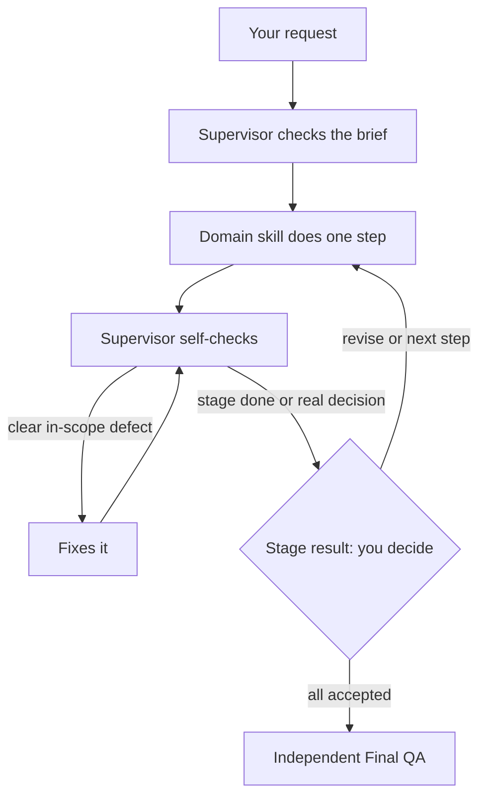

# Product Design Workflow

**A design partner for Claude that checks the brief, does the work step by step, and lets you make every call.**

A free, MIT-licensed Claude Code plugin by Della Mahmoudi, product designer. Eight skills plus one independent QA agent. No hooks, no MCP servers, no scripts.

You ask for design work the way you normally would. A Supervisor skill picks it up, checks whether the brief is ready, loads only the design expertise that step needs, checks its own work against design-system and accessibility standards, fixes clear in-scope problems itself, and then pauses at the end of each stage so you decide what happens next. It also stops early for a real product or taste decision, missing permission, or when it isn't making progress. When everything is accepted, a separate Final QA agent gives the finished deliverable a fresh, independent review. It is instructed not to write (see [Optional connectors](#optional-connectors)).

**Nothing moves forward until you say so.** The plugin advises. You decide.

## Why I built it

Design work slows down for the same few reasons again and again:

- tasks show up **without context**: no goal, no acceptance criteria, no constraints
- **data is missing**, so people guess and redo it later
- **too many rounds of edits**, because problems surface late
- **design-system rules get lost**, so components, tokens and states drift

This plugin builds those checks into the workflow. It asks one focused question only when a real product decision is blocking, applies the domain standards while working, fixes obvious defects before you ever see them, and at the end of each stage tells you what it made, what it checked and what is still open.

## Requirements

- [Claude Code](https://code.claude.com/docs) with plugin support (requires a paid Claude plan or API access).
- Use your strongest available model.

## Install

Run these two commands in Claude Code:

```text
/plugin marketplace add dellamahmoudi93-max/product-design-workflow
/plugin install product-design-workflow@product-design-workflow
```

The first command adds the marketplace. The second installs the `product-design-workflow` plugin from the `product-design-workflow` marketplace (same name for both).

Then restart Claude Code or run `/reload-plugins`, and run `/plugin` to confirm it is installed.

> Already have standalone copies of these skills? Remove them first, otherwise two copies can respond to the same request.

**Update**

```text
/plugin marketplace update product-design-workflow
```

Then run `/reload-plugins` or restart Claude Code.

**Uninstall**

```text
/plugin uninstall product-design-workflow@product-design-workflow
/plugin marketplace remove product-design-workflow
```

## What it works on

Works on briefs, text, screenshots and specs. Figma integration is experimental and untested.

## Your first prompt

Copy this, swap in your own details, and paste it into Claude:

```text
I'm working on [product / feature]. Here's the brief: [paste brief, link or notes].

Before you start, check whether the brief is ready and tell me what's missing.
Then break the work into steps, do the first one, and stop so I can review it.
```

You don't need to name the plugin. The Supervisor is the default entry point for design requests, and it understands requests in English, Persian and Finglish (Persian written in Latin letters), because those are the author's working languages.

## What you can ask for

| You say | What happens |
|---|---|
| "Design this settings screen" | Readiness check, then UI and interaction work, reviewed for states, accessibility and responsiveness |
| "Review this checkout flow" | Structural and interaction review with a clear list of misses and a recommendation |
| "Rewrite this button label" | A small request stays a single step, no ceremony |
| "The CEO wants a dashboard, where do we start?" | Discovery framing: users, facts vs. assumptions, risks, MVP scope, success metrics |
| "Is this ready for dev?" | Handoff completeness, acceptance criteria and Definition of Done |
| "Audit our buttons against the design system" | Reuse vs. create decisions, token and variant consistency |
| «این صفحه رو طراحی کن» | Same workflow, in Persian |

## What's inside

The domain skills carry concrete, checkable knowledge rather than generic advice:

- **Accessibility mappings**: WCAG 2.2 criteria and WAI-ARIA APG patterns mapped to states, focus, keyboard, errors and contrast.
- **Design-system consumption rules**: reuse > compose > extend > create, token and variant consistency, Figma vs code parity.
- **Handoff checklists**: Ready-for-Dev, acceptance criteria, Definition of Done, implementation QA.
- **RTL, dark mode, responsive and localization checks** for the visual layer.
- **Quality gates** that separate hard failures from flags. For example, from `ui-visual-design`:

> **Fail: fix before calling the design done.**
> - Text or required non-text contrast misses the applicable threshold.
> - Color is the only carrier of meaning or state, or states are indistinguishable.
> - Focus can't be seen.

| Component | Type | Purpose |
|---|---|---|
| `product-design-supervisor` | Skill | Entry point. Frames scope, checks readiness, splits work into steps, selects domain skills, self-checks and repairs clear defects, pauses for your decision after each stage, then hands off to Final QA and waits for you after its report. |
| `product-discovery-framing` | Skill | Turns vague briefs and "the CEO wants X" into a real problem frame: users, facts vs. assumptions, risk, MVP scope, success metrics. |
| `ux-architecture` | Skill | IA, navigation, taxonomy, labels, sitemaps, structural user flows and journeys, findability. |
| `interaction-design` | Skill | Behavior: states, feedback, validation, errors and recovery, loading/async, focus and keyboard, interaction copy. |
| `ui-visual-design` | Skill | Visual layer: hierarchy, layout, spacing, typography, color and contrast, responsive, dark mode, RTL. |
| `design-systems-consistency` | Skill | Reuse vs. create decisions, component APIs and variants, token architecture, audits, governance, deprecation, Figma vs code parity. |
| `prototype-testing-analytics` | Skill | Prototype and usability-test planning, research findings, UX metrics, tracking plans, A/B experiments. |
| `delivery-product-collaboration` | Skill | Ready-for-Dev, handoff completeness, acceptance criteria, Definition of Done, implementation QA. |
| `independent-final-qa` | Agent | Fresh, independent review of the finished deliverable against scope and standards. Returns PASS / FAIL / BLOCKED; the report is shown unchanged and any re-check after fixes is a fresh review. Instructed not to write. Edit, Write, MultiEdit, NotebookEdit and Bash are blocked; it still inherits MCP tools from your session, so connected write tools (e.g. Figma, Gmail) are not technically blocked. |

Each domain skill comes with `references/` (standards, with a `source-map.md` pointing to public sources such as WCAG 2.2, WAI-ARIA APG, NN/g, GOV.UK, Material and Carbon) and `evals/`: eval specs (test cases with pass/fail criteria). The `evals.json` files follow the format used by Anthropic's [skill-creator](https://github.com/anthropics/skills/tree/main/skills/skill-creator) skill, which can run them against a skill. These are specs only; no results are published. Works without the original books; links are for optional verification.

## Optional connectors

Figma, Google Drive and browser tools help with grounding and QA. Final QA agent: Instructed not to write. Edit, Write, MultiEdit, NotebookEdit and Bash are blocked; it still inherits MCP tools from your session, so connected write tools (e.g. Figma, Gmail) are not technically blocked. It is told never to submit, save, publish, share, pay or delete. Browser tools can still click and type, so point QA at a safe preview. Without suitable tools, QA marks the affected criteria BLOCKED instead of guessing.

## How it works



A few ground rules it follows:

- It never invents facts or quietly makes product decisions for you.
- It never retries, repairs or escalates on its own.
- A technical "pass" is advice, not approval. You approve.

## Known limits

- Skills activate by description matching, not a guaranteed hook.
- Figma reads and writes, document creation, media generation and interactive browser QA have not been quality-tested.

## Release notes

Current version: 0.3.2. See [docs/RELEASE-NOTES.md](docs/RELEASE-NOTES.md).

## License and author

MIT, see [LICENSE](LICENSE). Made by [Della Mahmoudi](https://github.com/dellamahmoudi93-max), product designer.
