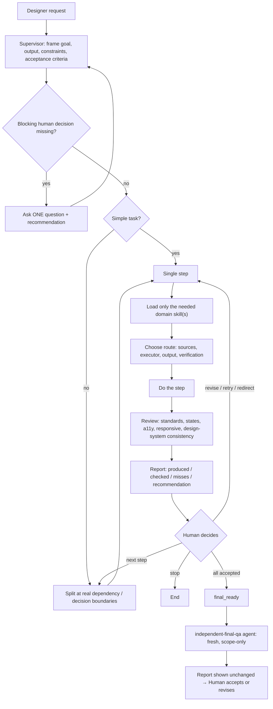

# Product Design Workflow — Claude plugin

A supervised product-design workflow for Claude (Claude Code and Cowork). One **Supervisor** skill runs the designer's task: it checks that the brief is ready, gathers what's missing, breaks the work into steps, loads only the design expertise each step needs, checks the result against design-system and accessibility standards, and then **stops so the designer decides what happens next**. At the end, a separate **Final QA agent** reviews the finished deliverable.

## The problem it solves

Design teams lose time because:

- tasks arrive **without context** (no goal, no acceptance criteria, no constraints);
- **data is missing or incomplete**, so designers guess and rework later;
- there are **too many rounds of edits**, because problems show up late;
- people **don't know the design-system rules**, so components, tokens and states drift.

This plugin puts those checks into the workflow itself. Before work starts, the Supervisor checks readiness and asks one focused question only when a real product decision is blocking. During the work it applies the domain standards. After each result it reports what was done, what it checked and what is still open. The human keeps every decision.

## Install (Claude Code)

```text
/plugin marketplace add dellamahmoudi93-max/product-design-workflow
/plugin install product-design-workflow@product-design-workflow
```

Then just ask for design work, e.g. "design this settings screen", "review this checkout flow", "rewrite this button label". The Supervisor is the entry point. It also understands Persian and Finglish requests.

> If you already installed standalone copies of these skills, remove them first, otherwise two copies can trigger for the same request.

## What's inside

| Component | Type | Purpose |
|---|---|---|
| `product-design-supervisor` | Skill | Entry point. Frames scope, checks readiness, splits work into steps, selects domain skills, reviews each result, pauses for a human decision, then hands off to Final QA. |
| `product-discovery-framing` | Skill | Turns vague briefs and "the CEO wants X" into a real problem frame: users, facts vs. assumptions, risk, MVP scope, success metrics. |
| `ux-architecture` | Skill | IA, navigation, taxonomy, labels, sitemaps, structural user flows and journeys, findability. |
| `interaction-design` | Skill | Behavior: states, feedback, validation, errors and recovery, loading/async, focus and keyboard, interaction copy. |
| `ui-visual-design` | Skill | Visual layer: hierarchy, layout, spacing, typography, color and contrast, responsive, dark mode, RTL. |
| `design-systems-consistency` | Skill | Reuse vs. create decisions, component APIs and variants, token architecture, audits, governance, deprecation, Figma ↔ code parity. |
| `prototype-testing-analytics` | Skill | Prototype and usability-test planning, research findings, UX metrics, tracking plans, A/B experiments. |
| `delivery-product-collaboration` | Skill | Ready-for-Dev, handoff completeness, acceptance criteria, Definition of Done, implementation QA. |
| `refresh-capability-index` | Skill | Maintenance only. Runs only when you ask to benchmark or update the Supervisor's capability index. Ships the method and a findings summary; raw pilot data and evaluation kits are not included. |
| `independent-final-qa` | Agent | Fresh, read-only review of the finished deliverable against scope and standards. Returns PASS / FAIL / BLOCKED. |

Each domain skill has `references/` (standards, with a `source-map.md` citing public sources such as WCAG 2.2, WAI-ARIA APG, NN/g, GOV.UK, Material, Carbon) and `evals/` (test cases).

The plugin adds no hooks, no MCP servers and no scripts.

## How the Supervisor works



Key rules: it never invents facts or silently makes product decisions; it never retries, repairs or escalates on its own; a technical "pass" is advice, not approval.

## Model and cost guidance

Based on what each skill actually asks the model to do. This is guidance, not a benchmark. Use whatever model your plan and runtime expose; quality comes first.

| Component | Main task | Suggested tier |
|---|---|---|
| `product-design-supervisor` | Multi-step judgment: readiness triage, scope control, routing, reviewing other output | **Strong** (your best default model) |
| `independent-final-qa` | Independent check against every criterion, honest FAIL/BLOCKED | **Strong** |
| `product-discovery-framing` | Ambiguous briefs, separating evidence from assumption, risk trade-offs | **Strong** |
| `design-systems-consistency` | Semantic token/component reasoning, migration, governance impact | **Strong** for architecture and migration; **mid/fast** for simple raw-value audits |
| `delivery-product-collaboration` | Handoff and acceptance-criteria checklists; parity QA | **Mid** for checklists and AC; **strong** for complex implementation-QA judgment |
| `ux-architecture` | IA and flow structuring | **Mid**, **strong** for large or permission-heavy IA |
| `interaction-design` | State modeling and edge cases; microcopy | **Mid** for copy and simple states; **strong** for complex async, permission or AI behavior |
| `prototype-testing-analytics` | Study plans, metric definitions, experiment design | **Mid** for plans and tracking specs; **strong** for causal or statistical interpretation |
| `ui-visual-design` | Applying an existing design system to a screen; visual critique | **Mid/fast** for routine specs and critique; **strong** for new hierarchy problems |
| `refresh-capability-index` | Benchmark method and evidence handling | **Strong** (rarely run) |

"Fast" means the cheaper or faster tier in your plan (for example, Haiku-class models). "Mid" means Sonnet-class models and "strong" means your top tier. The agent uses `model: inherit`, so it runs on the session model.

## Optional connectors

Figma, Google Drive and browser tools improve grounding and QA. The QA agent has no fixed tool list: it inherits whatever tools your session has (any connected browser or Figma MCP), with file-writing tools and Bash disabled. It is told never to submit, save, publish, share, pay or delete. Browser tools can still click and type, so point QA at a safe preview. Without suitable tools, QA marks the affected criteria inaccessible/BLOCKED rather than guessing.

## Release notes

See [docs/RELEASE-NOTES.md](docs/RELEASE-NOTES.md).

## License

MIT, see [LICENSE](LICENSE).
