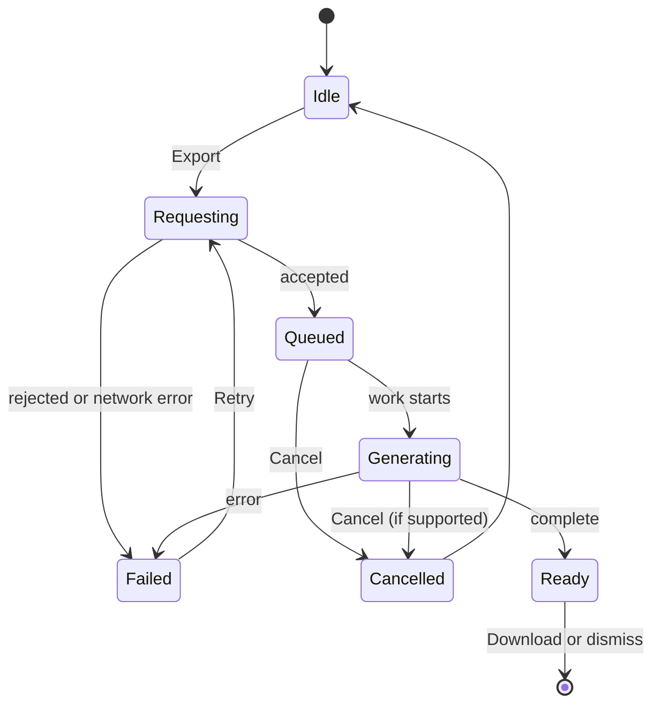

# Behavior and state modeling

Load for multi-state, asynchronous, branching or multi-step interactions; selection, editing, filtering, command and drag behavior; form structure; permissions; and any Deep spec. The fast defaults for common control choices are in SKILL.md and are not repeated here. Error, feedback and recovery details live in `feedback-errors-and-recovery.md`. Which steps and destinations a task has comes from `ux-architecture`; this file specifies behavior within them.

Sections: 1 Goal-directed framing · 2 The action contract · 3 Pattern decisions · 4 Selection, editing, commands, drag · 5 Forms and input behavior · 6 Multi-step and interruptible tasks · 7 Permissions and conditional behavior · 8 State inventory · 9 Choosing a representation (with examples) · 10 Behavior spec template

## 1 Goal-directed framing

- **Start from the user's end goal**, not the feature or today's task steps. Goals stay stable while tasks change with technology, so a step that serves the system rather than the goal is *excise*: remove it, automate it, or make it optional. (AF CH1 "Recognizing User Goals"; CH12 "Goal-Directed Tasks versus Excise Tasks")
- **Match the represented model to the user's mental model**, not to the implementation. One button per API call, one dialog per module and one page per backend step are symptoms of mirroring the code. (AF CH1 "Implementation Models and Mental Models")
- **Diagnose with the two gulfs.** Execution: can the user tell which actions are possible and how to perform them? Evaluation: can they tell what happened and what state things are in now? Most interaction defects are a missing signifier, mapping, constraint or feedback. (DOET Ch 2 "The Gulfs of Execution and Evaluation"; Ch 1 "Fundamental Principles of Interaction")
- **Recognition over recall.** Show options, current values and the next step instead of making people remember them; keep what must be held in mind small; information needed later must not vanish before it is needed. (NN/g heuristic 6; DOET Ch 3 "The Tradeoff Between Knowledge in the World and in the Head", "Short-term or working memory")
- **Minimize thought per step, not clicks.** Each choice should be obvious and unambiguous; several mindless steps beat one that needs thinking. Keep controls where people learned them. (DMMT Ch 4 "Animal, Vegetable, or Mineral?"; DI Ch 1 "Spatial Memory")
- **Specify the probable path first, then provide for the possible:** key path → alternative branches → rare but necessary uses → edge cases. Keep rare cases off the main path but reachable. (AF CH4 "Three types of scenarios"; CH5 Steps 5–6; CH11 "Design for the probable but anticipate the possible")
- **Ask what a considerate human assistant would do**: remember what the user already said, avoid needless questions, keep them informed without interrupting, take responsibility when things fail. (AF CH8 "Designing Considerate Products"; CH5 "Pretend the product is human")

## 2 The action contract

Every meaningful action needs an answer to each question; a question nobody answered is a defect waiting to ship. Write down only the answers that aren't obvious: for a simple control most are one line or go without saying, and a field filled for form's sake is noise.

| Element | Question to answer |
|---|---|
| Trigger | Who or what starts it: user (click, tap, key, gesture, voice), a system event, or a timer? |
| Preconditions and guards | What must be true first? If it isn't: hidden, disabled with a reason, or explained on activation (§7)? |
| Acknowledgment | What changes immediately so the user knows the input registered? |
| Effect | What changes in the system: locally, on the server, for other people? Is it reversible? Mark unknowns `[confirm: engineering]`. |
| Feedback | What does the user perceive while waiting, on success and on failure, visually, in text and through assistive technology? |
| Resulting state | Where is the user now, what is selected and focused, what is possible next? |
| Exits | How can they cancel, undo, go back or retry, and which of these does the system really support? |

- **Commit timing.** With a pointer, press proposes and release commits; moving off before release cancels. (AF CH18 "Mouse-up and mouse-down events"; WCAG 2.5.2) A single click or tap selects or activates; a double-click is an accelerator that always has a single-action equivalent. (AF CH18 "Double-clicking"; DI Ch 8 "Single-Clicking Versus Double-Clicking Items")
- **Command vs configuration.** Run commands with sensible or last-used settings and keep configuration separate instead of interrogating the user every time. (AF CH11 "Differentiate between command and configuration", "Provide choices rather than ask questions")
- **Changing a value must not by itself change the context** (navigate, submit, move focus elsewhere) unless the user was told beforehand. (WCAG 3.2.2; focus alone never does it, 3.2.1)

## 3 Pattern decisions

| Decision | Default | Switch when | Sources |
|---|---|---|---|
| Instant vs applied filters | Instant results with a visible result count and active filters when queries are fast | An Apply button when queries are slow or costly, or users compose several conditions first; don't re-query per keystroke if that slows typing | DI Ch 9 "Dynamic Queries", "Searching and Filtering" |
| Autosave vs explicit save | Autosave with a visible save status for document-like editing `[confirm: engineering]` | Explicit Save or Submit for transactional, shared or approval-bound changes, with a visible unsaved state | AF CH14 "Automatic save" |
| Wizard vs single form | A single page for short or familiar tasks | A wizard for long, branched, unfamiliar, infrequent tasks; split at decision points so branches skip steps; Back keeps answers | DI Ch 2 "Wizard"; AF CH16 "Pros and cons of wizards" |
| Expand in place vs drill down vs split view | Expand in place (list inlay) for a quick look in context | Drill-down on small screens; split view for browsing items one at a time on wide screens | DI Ch 7 "List Inlay", "One-Window Drilldown", "Two-Panel Selector or Split View" |
| Menu vs toolbar vs inline action | Place by frequency, disruption and risk: frequent → visible; rare → menu; dangerous → away from frequent controls | Toolbars and shortcuts for intermediates; show shortcuts in menus so people learn them | AF CH10 "Organizing for inflection"; CH11 "Hide the ejector seat levers"; CH18 "Menus as a pedagogic vector" |
| Preview before commit | Preview costly or hard-to-reverse operations and commit from the preview | Skip when the effect is immediately visible and cheap to undo | DI Ch 8 "Preview"; AF CH15 "What If: Compare and Preview" |
| Pagination vs load more vs infinite scroll | Pagination or "Load more" with a count for lists people scan or return to | Infinite scroll only for feeds: it hides footers, is weak for keyboard and screen-reader users, and can lose the place on Back | AF CH20 "Paging versus infinite scrolling"; DI Ch 6 "Infinite List" |
| Notification type | Inline, next to what it concerns | Toast for system events not tied to one region; banner for service-wide issues; never timed dismissal for critical messages | Carbon Notifications; Apple Feedback |

Wizard vs single form and drill-down vs split view also shape a task's steps and navigation. When an approved flow already settles them, specify behavior within it; when the open question is which steps or destinations exist, it belongs to `ux-architecture`.

## 4 Selection, editing, commands, drag

- **Object first, then action.** Keep the selection visible and unambiguous by more than color. (AF CH18 "Command ordering and selection", "Visual indication of selection"; WCAG 1.4.1)
- **Selection is exclusive by default**; additive selection uses checkboxes or modifier keys. Focus and selection are different things and both must be visible. (AF CH18 "Additive selection"; APG Developing a Keyboard Interface)
- **Bulk actions** show the selected count and the scope. Define "select all" explicitly (this page or all matching results) and what happens to the selection on filter, sort and pagination; this is a frequent source of costly mistakes. In batch mode, make per-row actions that would conflict unavailable, and let the user leave batch mode. (Carbon Data table "Batch actions", "Selectable"; DI Ch 8 "Smart Menu Items": labels name their target)
- **Editing**: inline edit for single values; an edit mode with explicit Save and Cancel for multi-field changes; Escape cancels an in-place edit. Don't silently auto-correct: highlight suspect input and let the user decide ("Audit, don't edit"). Leaving with unsaved changes → feedback file §11. (AF CH14 "Auditing versus editing")
- **Commands** use a verb (plus object) and stay in stable places, because people rely on spatial memory. Prefer disabled-with-reason over hiding when the command will become available. (DI Ch 1 "Spatial Memory"; AF CH18 "Disabled menu items")
- **Repetition**: when users repeat work, offer one action for it (apply to all, bulk edit); keep a history for long-running work. (DI Ch 1 "Streamlined Repetition"; Ch 8 "Command History")
- **Direct manipulation and drag**: give immediate feedback; identify what is being dragged; valid targets show they can receive it; show the insertion point; dropping on an invalid target does nothing; Escape cancels; tiny accidental movements are ignored; scrollable targets auto-scroll. Always provide a non-drag way to do the same thing. (AF CH13 "Direct Manipulation and Pliancy"; CH18 "Drag and drop"; WCAG 2.5.7)
- **Signal what is interactive** without depending on hover, which touch screens and keyboards don't have. (AF CH13 "Pliancy and hinting"; DMMT Ch 10 "No cursor = no hover = no clue")

## 5 Forms and input behavior

Validation timing, error messages and recovery are in the feedback file §4.

- **Ask only what the task needs**; infer or prefill the rest; never pre-tick consent or marketing options. (DMMT Ch 11 "Things that diminish goodwill"; DI Ch 10 "Good Defaults and Smart Prefills")
- **Accept reasonable formats and normalize them** (spaces, dashes, case), then show the canonical form. (DI Ch 10 "Forgiving Format"; GOV.UK Validation; DOET Ch 2 "Entering Dates, Times, and Telephone Numbers")
- **Bounded controls** (select, stepper, date picker) when the valid set is small and known; otherwise free entry plus validation. Split "structured" fields only for truly fixed formats, and make sure paste and autofill still work. (AF CH21 "Bounded and unbounded entry controls"; DI Ch 10 "Structured Format")
- **Visible labels always**; placeholder text is not a label because it reads as already filled in and disappears on entry. Hints sit outside the field. (DI Ch 10 "The Basics of Form Design", "Input Hints"; Carbon Forms "Placeholder text"; WCAG 3.3.2)
- **Don't make people re-enter** what they already gave in the same process; prefill it or let them pick it. (WCAG 3.3.7) Identify the purpose of personal-data fields so autofill works. (WCAG 1.3.5)
- **Autocomplete suggests and never hijacks**: what the user types wins, and suggestions are accepted explicitly unless the chosen autocomplete mode says otherwise. (DI Ch 10 "Autocompletion"; APG Combobox autocomplete modes)

## 6 Multi-step and interruptible tasks

The steps and their order come from the flow (`ux-architecture`); specify how people move through them, back out, get interrupted and resume.

- Show where the user is and what remains; let them go back without losing answers and revise earlier ones. (DI Ch 3 "Progress Indicator"; Ch 2 "Wizard")
- Before a consequential commit (legal, financial, data), let users review and correct, or make the result reversible. (WCAG 3.3.4; DI Ch 8 "Preview")
- Assume interruption: preserve inputs, position and system state, resume where the user left off, and never auto-close or auto-clear the user's items. (DOET Ch 5 "Understanding Why There Is Error", "Designing for Error"; DI Ch 1 "Changes in Midstream", "Microbreaks", "Prospective Memory")
- Save-and-resume, drafts and deep-linkable steps need engineering support `[confirm: engineering]`: specify the supported behavior and the fallback.
- Time limits and session expiry → feedback file §11.

## 7 Permissions and conditional behavior

Decide per action and per role:

| Situation | Behavior |
|---|---|
| This user can never perform it, and knowing it exists doesn't help them | Hide it |
| Temporarily unavailable (prerequisite, dependency, current state) | Show it disabled, with the reason and how to enable it close by; keep it discoverable to assistive technology (`aria-disabled` where focusability helps) |
| The user could gain access (request it, upgrade, ask an owner) | Show it; on activation explain why it's unavailable and offer the path `[confirm: product]` |
| The content matters but can't be changed | Read-only, still readable by assistive technology |

(Carbon "Disabled states"; APG Developing a Keyboard Interface, on disabled elements; GOV.UK Button, on disabled buttons)

- **The server must decide.** Hiding or disabling in the UI is a courtesy, not enforcement; whether the server checks the permission is `[confirm: engineering]`, never an assumption. Still design the "not allowed" response at the moment of action for stale screens and changed roles.
- **Sensitive operations may require re-authentication**: specify where it interrupts and how the user returns to the same step `[confirm: security]`. Authentication must not depend on memorizing or solving puzzles without an alternative such as paste or a password manager. (WCAG 3.3.8)
- **Actions that affect other people** (shared resources, removing members, transferring ownership) need explicit decisions on who is told, when, and what they see next `[confirm: product]`.
- **Eligibility and permission refusals are not validation errors**: explain why and what to do next. (GOV.UK Error message, when not to use; GOV.UK Validation)

## 8 State inventory

Walk the list and keep only states that can really occur for this interaction. For each one, specify what is visible, what is enabled, what is announced, and how to leave it.

- **Empty**: first use (what will appear here and the one next action), no results (why, and how to broaden), cleared by the user, empty because of an error. (Carbon "Empty states": no-data, user-action and error-management types)
- **Loading**: initial (skeletons for container and data components only), incremental or "load more", background refresh (keep current data visible), action pending. (Carbon "Loading")
- **Populated**: the ideal state.
- **Partial**: some data failed to load, or some items succeeded and others didn't (feedback file §8).
- **Pending or optimistic** (feedback file §3).
- **Success**: only where the result is significant or not otherwise visible. (Apple Feedback)
- **Error**: field, component, page or system level; recoverable or not.
- **Unavailable**: disabled, read-only, hidden, permission-limited (§7).
- **Stale or conflicted**: changed elsewhere (feedback file §10).
- **Offline or degraded** (feedback file §9).
- **Control interaction states**: default, hover, focus, pressed, selected, dragging, disabled. Name which apply and what each means for behavior; how they look belongs to `ui-visual-design`, and whether a component supports them to `design-systems-consistency`.

## 9 Choosing a representation

Use the lightest form that makes the behavior unambiguous. A formal model (state table or diagram) earns its place only when the behavior is meaningfully multi-state, asynchronous, branching, destructive, concurrent or recoverable. Artifact size is not a quality signal; behavioral clarity is.

| Form | Use when |
|---|---|
| Behavior rules (bullets) | Up to three states, no asynchronous work, no branching: most single controls |
| State table | Finite states with several events; the default for Standard mode; easy for engineers and QA to check |
| Mermaid state diagram (`stateDiagram-v2`) | Branching, asynchronous work with timeout or cancel, guards, cancel from many states, or parallel regions such as per-item plus aggregate |
| YAML or JSON | Only when the user asks or engineering will consume it directly |

Name states by what is true for the user ("Sending invite"), not by implementation ("POST /invites"). Every state needs an exit; every asynchronous state needs success and failure, plus timeout and cancel where the user can lose patience. Note any transitions that must be impossible.

**Example A: behavior rules** (web settings switch, "Show completed tasks")
- Takes effect immediately; no Save button. The label stays constant; state is conveyed by the switch itself (`role="switch"`, `aria-checked`) and visible on/off text, not by color alone.
- If saving takes over about a second, show an inline "Saving…" status. On failure, revert the switch, show an inline error with "Try again", and keep focus on the switch.
- `[confirm: engineering]` whether the preference is stored per device or per account.

**Example B: state table** (inline "Resend invite" action)

| State | User sees and can do | Event → next state | Feedback |
|---|---|---|---|
| Idle | "Resend invite" button | Activate → Sending | — |
| Sending | Button shows busy; repeat activation is ignored | Success → Sent; error → Failed; no response in N s → Unknown | Busy status announced if longer than about a second |
| Sent | "Invite sent 14:02"; button returns after a cooldown `[confirm: product]` | — | Status message |
| Failed | Inline error with the reason and "Try again" | Retry → Sending | Error announced; focus stays on the control |
| Unknown | "We couldn't confirm the invite was sent" with "Check status" | Check → Sent or Failed | Status message |

**Example C: state machine** (asynchronous "Export report" job)



Annotate what the diagram can't show: whether the job continues if the user leaves, and how they are told it's ready `[confirm: engineering]`; whether Cancel during Generating stops server work `[confirm: engineering]`; how long a Ready file stays available `[confirm: product]`.

## 10 Behavior spec template (Deep mode)

Fill only the fields that apply and drop the rest; where a reader would expect a field, write "n/a" rather than inventing content.

```
Interaction:              Platform / design system:          Mode: Deep
User goal and intention:
Actors and permissions:
Preconditions and guards:
Starting state:
Actions and triggers:     user / system / time
States and transitions:   table or Mermaid; one row per From | Event | Guard | To | System response | Feedback
Feedback:                 visual, text, announced; haptic or sound only where the platform uses them
Success conditions:
Failure and recovery:     by type (feedback file §5); recoverable vs unrecoverable
Cancel / undo / back / retry: and what the system really supports
Other actors, concurrency: who else is affected or editing at the same time, what they see and when
Edge cases:               only the plausible, costly ones (feedback file §12)
Accessibility and input:  keyboard, focus placement and restoration, names and states, announcements, pointer and touch
Interaction copy:         labels, confirmations, errors, status
Assumptions and dependencies: capabilities as confirmed [given], assumed [assumption], proposed,
                          or needing validation [confirm: engineering]; design-system gaps [confirm: design system]
Validation needs:         what to test and with whom; the study belongs to prototype-testing-analytics
Open decisions:
Confidence:               high / medium / low, and why
```

Represent the logic once: a state table, or a Mermaid diagram when branching makes the table hard to follow; both only when the diagram adds something the table can't show. Keep the spec as short as engineering and QA can build and test from.
