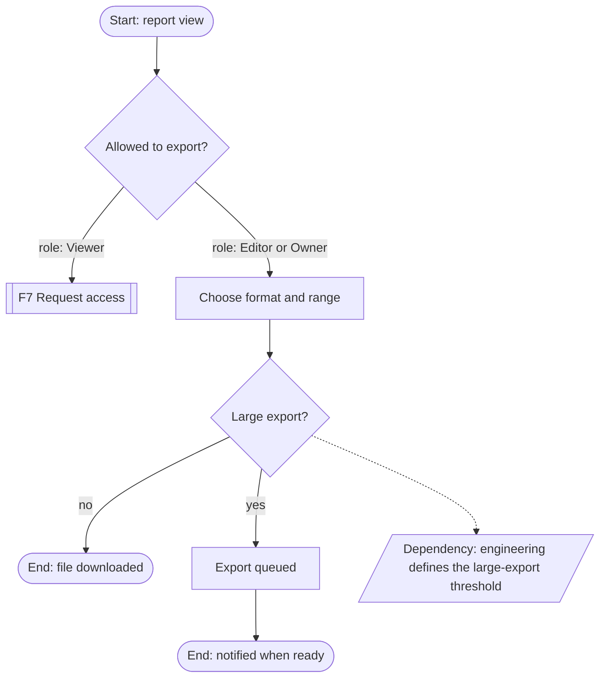

# Flows and journeys

Read only the sections the task needs.

**Contents**
1. Pick the right artifact
2. Task models
3. Scenario-based architecture (optional)
4. Building a task or user flow
5. Notation
6. Structural flow versus interaction detail
7. Journey maps
8. High-level service journeys
9. Flow completeness checks

**Source tags:** as in `ia-navigation-and-taxonomy.md`; full citations in `source-map.md`. **[inference]** marks design reasoning not stated by a source.

---

## 1. Pick the right artifact

| Artifact | Shows | Use when | Not for |
|---|---|---|---|
| Task model | What people do in their world to reach a goal, before any design (Smashing Ch12) | New product or feature; tasks unclear | Screen paths |
| Task flow | Steps and decisions of one task, independent of screens | Defining the logic and branches of a task | Layout or component behavior |
| User flow | The path through product destinations for one goal, including entry points | Designing or auditing how a task moves through the product | Detailed interaction states |
| Journey map | Stages over time, across sessions and channels, including steps outside the product | The experience spans sessions, channels or people | A single task on one screen |
| High-level service journey | User actions, frontstage touchpoints and named backstage dependencies | Services with offline steps, several channels or organizations | A full service blueprint, unless asked |

Terms vary. *Smashing UX Design* calls the ideal route through a product a "user journey" (Smashing Ch12), which is close to what many teams call a user flow. State the definition you're using.

Every artifact here is structural: it shows where people go, in what order and at which decisions. How a step behaves once someone acts belongs to `interaction-design` (section 6).

## 2. Task models

- **Evidence:** ask people to recount the last time they did the task, which is more reliable than asking what they would do, and observe where possible (Smashing Ch12). Without research, build the model from requirements and label every task an Assumption.
- **Build:** list sub-tasks, cluster them, note frequency, remove duplicates, then order them into phases such as trigger, entry, explore, decide, act and follow up (Smashing Ch12). Layer entry points, content needed, failure points and roles on top (Smashing Ch12).
- **Prioritize** by frequency and importance, using Tier 0 data when available. Goals stay stable while tasks change with technology, so structure around goals and treat tasks as the current means (AF Ch1).
- **Dependencies:** record prerequisites (A must exist before B), blocking conditions and tasks that can run in parallel. A task that can't start yet is a structural fact for flows and task lists (GOV.UK Task list).
- **Use the model:** top tasks get short, obvious paths, decision criteria become filter attributes, and the content needed at each decision point tells you what each destination must hold (Smashing Ch12, Ch21).

Output: a task table (Task | Goal | Actor or role | Trigger | Preconditions and dependencies | Frequency | Importance | Evidence label).

## 3. Scenario-based architecture (optional)

Use this About Face method only when a product is new or complex and its functions haven't been grouped yet. Skip it for routine flows.

1. **Context scenario:** a short narrative of a persona's typical use, with no interface details (AF Ch4).
2. **Requirements:** express needs as object, action and context: data, functional, contextual, and other (business, brand, technical) (AF Ch4).
3. **Elements:** turn requirements into functional and data elements, and note containment versus association (AF Ch5).
4. **Groups:** group elements by co-use, sequence and mental model. Give separate views to goals that don't overlap and keep co-used items together (AF Ch5).
5. **Key path scenarios:** the most frequent paths, which get top-level placement and the shortest routes (AF Ch5).
6. **Validation scenarios:** alternative paths (branches off the key path), necessary-use (rare but required, which belongs somewhere findable such as settings or admin), and edge cases (handled, but placed deep) (AF Ch5). Mapping these to prominence tiers is [inference] from that chapter.

Stop at named views and how they relate. About Face places form factor, posture and layout in interaction design (AF Ch5). In this system, form factor, posture and input go to `interaction-design`, and layout to `ui-visual-design`.

## 4. Building a task or user flow

1. **Goal and end state.** Define the goal and the end state that means success. Name every actor and role.
2. **Entry points.** List them: navigation, search, deep link, notification or email, invitation link, onboarding, a hand-off from another flow, external systems such as single sign-on. Include only entry points that exist or that you mark Proposed.
3. **Key path first.** Draw the main path, then add branches.
4. **Branch only where the path or outcome differs.** Separate user decisions (choices) from system conditions (permission, eligibility, existing data, limits). Unknown conditions become dependencies, not invented rules.
5. **Role branches** go only where roles take different paths.
6. **Exits:** success, cancel or abandon (and where people land), task-level failure (cannot proceed, then where to), interruption or timeout, and hand-offs.
7. **Cross-flow links:** reference other flows by ID instead of copying them.
8. **Continuity:**
   - Long, multi-session transactions use a task list showing which tasks are done and which can't start yet, shown again when people return (GOV.UK Task list).
   - Don't ask for information already given in the same process (WCAG 3.3.7, A).
   - Changing an answer from a review step returns people to that review step (GOV.UK Check answers).
   - One-time actions such as payments must not repeat when someone presses back (GOV.UK Question pages).
9. **Chunking:**
   - For transactional forms, start with one question per page and merge only with evidence (GOV.UK Question pages).
   - A long, unfamiliar, branched task suits a wizard (Tidwell Ch2).
   - Several independent tasks done over several sessions suit a task list (GOV.UK Task list).
   - An end-to-end journey across separate services suits step-by-step navigation (GOV.UK Step by step).
   - Choose by session length and how strictly the order matters.
10. **Constraints to carry forward:**
    - Sign-in steps must not rely on solving, recalling or transcribing (WCAG 3.3.8, AA).
    - Time limits need to be adjustable (WCAG 2.2.1, A).
    - Accessibility conformance covers complete processes: one non-conforming step means the whole process doesn't conform (WCAG conformance requirement, Complete processes).

## 5. Notation

Use a Mermaid `flowchart TD`, or numbered steps when the flow is short.
- **IDs:** `F1_S1` for steps, `F1_D1` for decisions, `F1_E1` for end states, `F1_U1` for unknowns. Use underscores because dots break Mermaid IDs.
- **Shapes:** `([ ])` for start and end, `[ ]` for steps or destinations, `{ }` for decisions, `[[ ]]` for a hand-off to another flow, `[/ /]` for an unknown dependency.
- **Edge labels** state conditions, and role conditions start with `role:`.
- Keep each diagram to about 25 nodes and split by subflow. When several people act (for example a requester, an approver and a recipient), use one diagram per actor linked by hand-offs. Don't split one actor's path without need.
- Add one legend line under the diagram.

Example (generic):

Legend: `[[ ]]` hand-off to another flow · `[/ /]` unknown dependency · dotted edge = condition not yet defined.

## 6. Structural flow versus interaction detail

The flow answers where, what and in what order. How a step behaves belongs to `interaction-design`, even when it happens inside a flow you mapped.

| Belongs in the flow | Hand off as a dependency |
|---|---|
| Steps, decisions, branches, entry and exit points, hand-offs | Component states and their logic (hover, focus, pressed, disabled, loading), transitions, micro-interactions, motion (`interaction-design`) |
| The information needed at each step, by name | Validation rules and timing, formats, error message copy (`interaction-design`) |
| Task-level failure outcomes ("cannot proceed, go to X") | Error-handling and recovery logic, retry, cancel and undo mechanics, async and optimistic updates, state machines (`interaction-design`) |
| Who can do what, by role and scope | How a blocked action responds in the interface (`interaction-design`); API endpoints, payloads, status codes, backend authorization rules (engineering) |
| Notifications that start or continue someone's task, as touchpoints | Notification content, templates, delivery logic |
| Where people land after success or cancel | Confirmation feedback such as toasts, focus placement, keyboard interaction (`interaction-design`); layout of those screens (`ui-visual-design`) |

Example, a workspace invitation. The flow can run F1_S1 entry → F1_S2 choose workspace → F1_S3 select project → F1_S4 invite member → F1_E1 confirmation destination, with branches for permission, existing members and unknown seat limits. It doesn't specify button loading, when the email field validates, how long a toast stays, optimistic updates, focus restoration, retry mechanics, hover, modal transitions, disabled-state logic or keyboard interaction.

If a request asks what happens when someone clicks, or how loading, failure, validation or keyboard interaction should work, stop and route it to `interaction-design`; don't continue because the step sits inside a flow. When the architecture can't be finished without such an answer, or something else is unknown, write a dependency line, for example "Dependency (engineering): define X; affects branch F1_D2" or "Dependency (interaction-design): duplicate-invite handling; affects F1_D3". Never fill gaps with invented system behavior.

## 7. Journey maps

- **When:** the experience spans sessions, channels or people, or you need to see where the architecture breaks the larger experience.
- **Structure:** stages as columns. Rows for the user's goal, actions, touchpoints and channels, questions and needs, pain points and opportunities. Show an emotion curve only with evidence. *Smashing UX Design*'s customer experience map adds a business layer showing what the business provides at each stage. Conflicts between the two layers mark failure points (Smashing Ch13).
- **Existing products:** map the screens visited per task, back-tracking, dead ends, workarounds and drop-off points, using test sessions or analytics the user supplies, or expert review (Smashing Ch12). Without evidence, call it a **Hypothesis journey**. Running new sessions or analytics belongs to `prototype-testing-analytics`.
- **Architecture implications:** for each pain point, name the structural cause and the fix: a missing entry point, a wrong grouping, a missing cross-link, or context lost at a hand-off.

Output: a stage table. Add a diagram only when it adds clarity.

## 8. High-level service journeys

- **When:** a journey crosses channels (web, app, email, phone, in person), organizations, or back-office steps that shape what users can do.
- **Lanes:** user actions; frontstage touchpoints; backstage dependencies, named only; supporting systems and policies, named only.
- **Blueprints:** go to a full service blueprint only when asked, or when cross-touchpoint dependencies are the actual problem.
- **Step-by-step navigation:** GOV.UK's step-by-step pattern presents an end-to-end journey as numbered steps linking to the content and services for each step (GOV.UK Step by step).
  - Use it for journeys with a clear start and end and a required order.
  - Don't use it inside a single transactional service, which takes a task list instead.
  - Don't use it when most of the journey happens elsewhere or the steps have no logical order.
  - On GOV.UK, the pattern is available for prototypes only.

## 9. Flow completeness checks

- Every entry point leads into the flow, and every path ends in success, a defined exit or a hand-off. No dead ends.
- Each decision covers all outcomes, with unknowns shown as dependencies.
- Role and permission branches appear where paths differ, and nowhere else.
- Cancel and abandon paths exist, and the landing place is defined.
- Interruptions have a resume path, and saved progress and session expiry are addressed.
- Back navigation and change-answer loops are defined, and one-time actions are protected.
- Hand-offs to other flows are referenced, including flows for other actors (for example the person receiving an invitation).
- No invented backend, API or component behavior, and no behavior inside a step (loading, validation timing, toasts, focus, retry, transitions). Unknowns and hand-offs are listed with their owner.
- Destination names in the flow match the IA labels.
